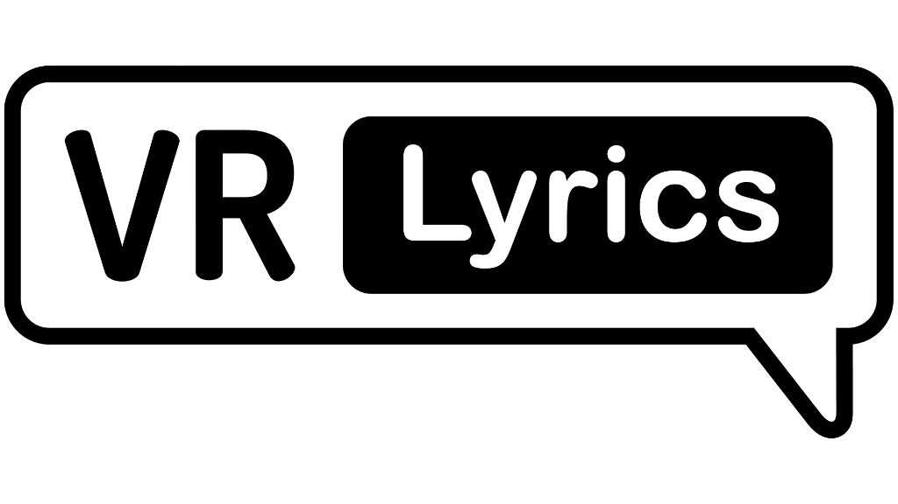
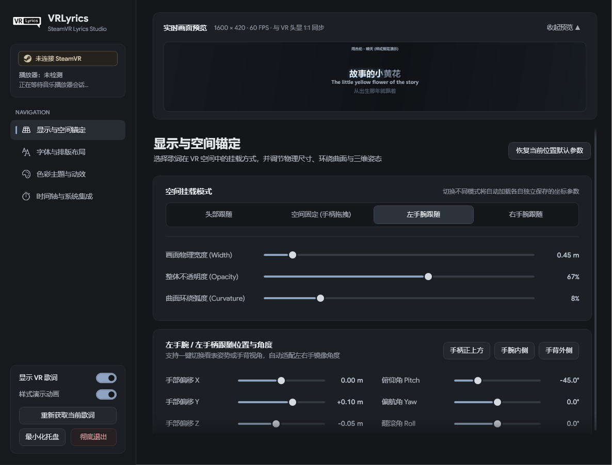
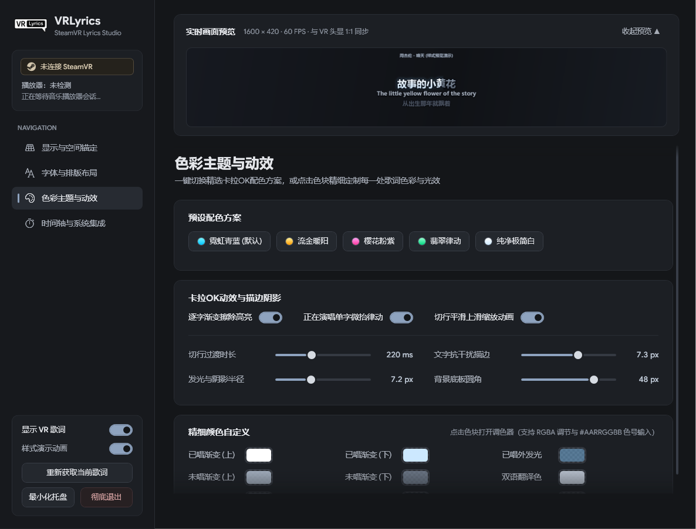
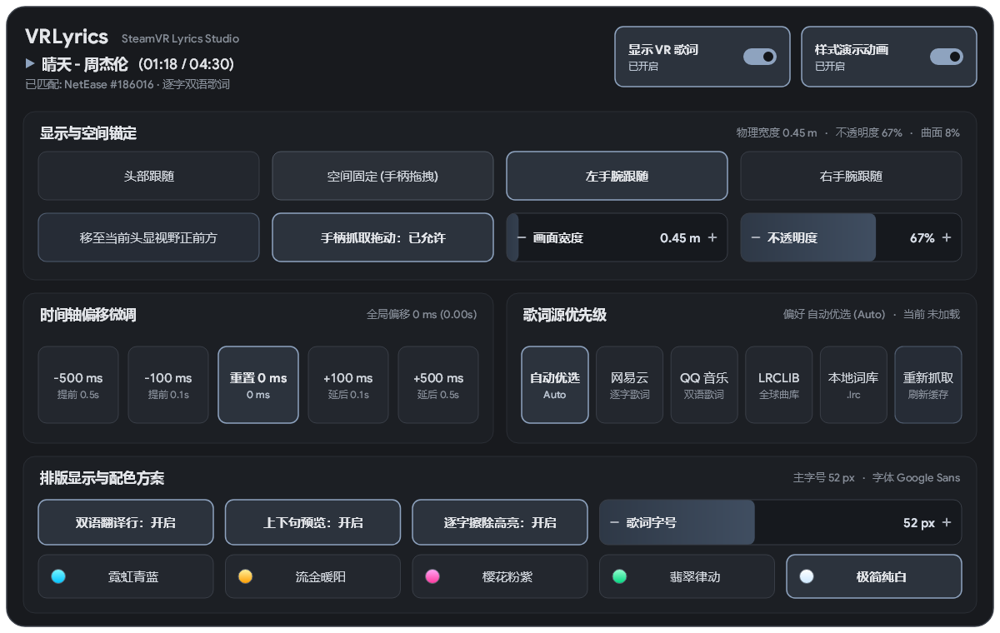

<div align="center">
  
  <h1>VRLyrics</h1>
  <p><strong>SteamVR 实时双语逐字卡拉OK歌词叠加层工具</strong></p>
  <p>
    <a href="LICENSE"></a>
    
    
    
  </p>
</div>

---

**VRLyrics** 是一款专为 SteamVR 玩家设计的轻量级实时同步歌词叠加层（Overlay）桌面工具。无需修改任何 VR 游戏，即可在头显视野、房间空间或左右手腕上悬浮显示当前音乐播放器的双语逐字卡拉OK歌词，并提供完整的 **SteamVR 仪表盘内控面板** 与 **桌面控制中心**。

## ✨ 核心特性

- 🎵 **多源歌词智能聚合**
  - 支持 **网易云音乐**（YRC 逐字时间轴 + 双语翻译）、**QQ 音乐**（LRC + 双语翻译）、**LRCLIB**（全球开源曲库）与 **本地 `.lrc` 文件夹**。
  - 支持自动优选与手动锁定歌词源优先级，内置内存 + 磁盘双层缓存。
- ⚡ **毫秒级播放进度同步**
  - 原生支持 Windows SMTC 系统媒体会话（Spotify、Apple Music、QQ 音乐、Foobar2000、浏览器等开箱即用）+ 高精度本地时钟插值。
  - 针对 **网易云音乐 PC 端 3.x** 内置专属 `cloudmusic.elog` 毫秒级日志探针，完美解决中途切歌或拖拽进度条后的时间轴同步问题。
- 🎨 **逐字卡拉OK动效与低饱和暗色主题**
  - 基于 **SkiaSharp + Direct3D 11 共享纹理** 实现 60 FPS 低占用渲染。
  - 支持单字渐变擦除高亮、已唱外发光、正在演唱单字微抬律动、切行平滑上滑缩放过渡。
  - 内置 5 套精选配色预设（霓虹青蓝、流金暖阳、樱花粉紫、翡翠律动、纯净极简白）及全通道 `#AARRGGBB` 调色器，内嵌开源 `Google Sans` 字体。
- 🌍 **4 种空间挂载模式与智能宽度记忆**
  - **头部跟随 (`HeadLocked`)**：锁定于头显视野下方/上方/左右下角，支持独立偏移与俯仰角调节。
  - **空间固定 (`WorldLocked`)**：固定在房间 3D 空间，支持 **VR 手柄扳机/侧键直接抓取拖动**、摇杆推拉远近，以及一键移至当前头显视野正前方。
  - **左 / 右手腕跟随 (`LeftHand` / `RightHand`)**：提供手柄正上方、手腕内侧、手背外侧快捷姿态。
  - **分模式宽度自动切换**：切换至手腕跟随模式时画面宽度自动调整为 `0.45 m`，切换回头部跟随或空间固定模式时自动恢复为 `1.00 m`（同时独立记忆用户在各模式下自定义的宽度预设）。
- 🥽 **SteamVR 叠加控制面板 (Dashboard Overlay)**
  - 在 VR 中按下手柄系统键呼出 SteamVR 菜单，点击底栏 **VRLyrics** 图标即可使用激光笔直接操作：切换挂载模式、拖拽手机音量条式滑块调节 **画面宽度 / 不透明度 / 歌词字号**、微调歌词时间轴偏移、切换歌词源与配色主题。
- 🚀 **SteamVR 生命周期深度集成**
  - 支持注册 `vrlyrics.vrmanifest` 实现 **随 SteamVR 启动自动运行** 与 **随 SteamVR 退出自动关闭**。
  - 自动检测管理员权限运行的 SteamVR（`vrserver.exe`），并在需要时智能引导提权连接。

---

## 📸 界面预览

### 桌面端控制中心
| 显示与空间锚定 | 色彩主题与动效自定义 |
| :---: | :---: |
|  |  |

### SteamVR 仪表盘内控面板 (VR Dashboard)
<div align="center">
  
</div>

---

## 📦 下载与安装（普通玩家）

请前往右侧 [**Releases**](../../releases) 页面下载最新版本压缩包：

| 版本包类型 | 文件名 | 适用人群与说明 |
| :--- | :--- | :--- |
| **独立免安装版（推荐）** | `VRLyrics-v2.x.x-Standalone-win-x64.zip` | **开箱即用**，已内置 .NET 10 运行时与全部依赖，解压到任意固定文件夹后双击 `VRLyrics.exe` 即可运行。 |
| **轻量便携版** | `VRLyrics-v2.x.x-win-x64.zip` | 体积仅 ~12 MB，需电脑已安装 [.NET 10 Desktop Runtime (x64)](https://dotnet.microsoft.com/download/dotnet/10.0)。 |

> [!NOTE]
> **使用小贴士：**
> 1. **请先解压到固定文件夹再运行**：程序启动时会在自身目录下生成 `vrlyrics.vrmanifest` 与图标文件供 SteamVR 识别，请勿直接在压缩包预览窗口中双击运行。
> 2. **关于 Windows SmartScreen 提示**：由于个人开源项目未购买商业数字签名证书，首次运行若弹出 Windows 蓝框提示“Windows 已保护你的电脑”，请点击 **“更多信息” -> “仍要运行”**。本项目 100% 源码公开并可通过 GitHub Actions 验证。

---

## 🛠️ 开发者快速开始

### 环境要求
- Windows 10 / 11 (x64)
- [.NET 10.0 SDK](https://dotnet.microsoft.com/download/dotnet/10.0)

### 1. 克隆并运行桌面端
```powershell
git clone https://github.com/crepper-exe/VRLyrics.git
cd VRLyrics
dotnet run --project "src/VRLyrics.App"
```

### 2. 运行单元测试
```powershell
dotnet test VRLyrics.sln -c Release
```

### 3. 一键编译打包发布
```powershell
# 构建独立自包含单文件版（免装 .NET 运行时，输出至 dist\VRLyrics-win-x64-selfcontained\）
powershell -ExecutionPolicy Bypass -File .\publish.ps1 -SelfContained

# 构建轻量便携版（依赖系统 .NET 10 Desktop Runtime，输出至 dist\VRLyrics-win-x64\）
powershell -ExecutionPolicy Bypass -File .\publish.ps1
```

---

## 📂 项目结构

```text
VRLyrics/
├─ src/
│  ├─ VRLyrics.Core/          # 核心模型、配置持久化 (SettingsService)、LRC/YRC 解析、时间轴与曲目匹配
│  ├─ VRLyrics.Providers/     # 网易云 / QQ音乐 / LRCLIB / 本地歌词提供程序与双层缓存
│  ├─ VRLyrics.Media/         # Windows SMTC 媒体会话追踪、网易云 elog 毫秒级探针与时钟插值
│  ├─ VRLyrics.Overlay/       # OpenVR 叠加层封装、D3D11 共享纹理桥接、SkiaSharp 渲染、VR 仪表盘与手柄抓取
│  ├─ VRLyrics.App/           # WPF 桌面主程序：设置窗口、调色器、系统托盘、单实例互斥、自启动管理
│  └─ VRLyrics.Cli/           # 命令行诊断与歌词检索测试工具
├─ tests/
│  └─ VRLyrics.Core.Tests/    # xUnit 单元测试（覆盖解析、渲染、3D 矩阵、手柄抓取、仪表盘命中、vrmanifest 等）
├─ docs/images/               # README 界面预览截图
├─ publish.ps1                # 一键单文件打包脚本（支持轻量版与 -SelfContained 独立版）
└─ VRLyrics.sln
```

---

## 📄 开源协议与免责声明

- **开源协议**：本项目基于 [MIT License](LICENSE) 协议开源。内置 `Google Sans` 字体遵循 [SIL Open Font License 1.1](src/VRLyrics.App/Assets/Fonts/OFL.txt)，`OpenVR SDK` 遵循 BSD 3-Clause 协议。
- **免责声明**：本项目完全免费开源，仅用于个人学习与非商业技术交流。程序仅通过公开接口检索文本歌词用于本地实时显示，不提供任何受版权保护的音频下载或破解服务；所有歌曲及歌词版权均归原音乐平台及著作权人所有。
